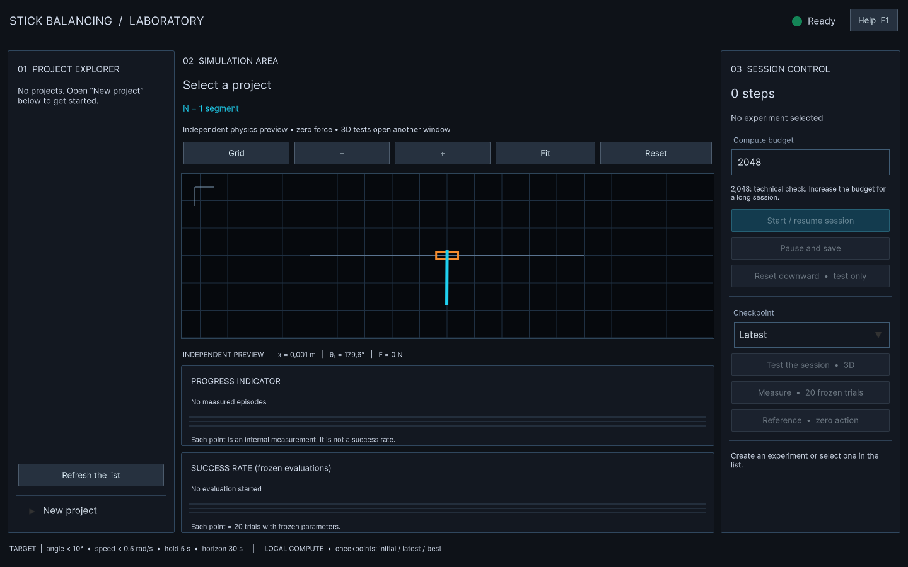
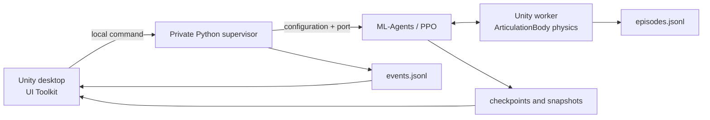

# Stick Balancing

**A Windows laboratory for experimenting with cart-pole control.**

[](#installation)
[](unity/ProjectSettings/ProjectVersion.txt)
[](docs/migration/unity-tests.xml)
[](tests/migration)
[](#project-status)

Stick Balancing combines a Unity physics simulation, a scientific desktop workspace, and a local reinforcement-learning pipeline. Users create isolated experiments, configure the pendulum, start or resume a session, inspect measurements, and evaluate a saved policy without modifying it.

All computation stays on the local machine. The packaged application includes its own runtime, so end users do not need to install Python, Unity, or ML-Agents.



> [!IMPORTANT]
> The complete technical pipeline works, but control competence has not yet been demonstrated. The latest documented frozen evaluation scored **0 successes out of 20 trials**. Changed weights or a higher reward do not, by themselves, prove physical success.

## Contents

- [Highlights](#highlights)
- [Workspace](#workspace)
- [Installation](#installation)
- [First experiment](#first-experiment)
- [Scientific model](#scientific-model)
- [Architecture](#architecture)
- [Experiments and checkpoints](#experiments-and-checkpoints)
- [Development](#development)
- [Tests and evidence](#tests-and-evidence)
- [Windows distribution](#windows-distribution)
- [Troubleshooting](#troubleshooting)
- [Project status](#project-status)

## Highlights

- Local simulation of a cart with **one to three articulated segments**.
- Passive joints with no hidden joint motor or feedback controller.
- Reproducible projects with configurable seed, segment count, length, and force limit.
- Start, resume, pause, and checkpoint a local session.
- `initial`, `latest`, and `best` policy snapshots.
- Deterministic evaluation kept separate from optimization.
- Zero-action, initial-policy, and random-policy reference evaluations.
- Progress and frozen-success charts.
- Independent physics preview with a metric grid, zoom, fit, reset, and telemetry.
- Private Windows x64 Python runtime with pinned dependencies.
- Offline-capable Windows installer built with Inno Setup.

## Workspace

The desktop follows the working model used by scientific and CAD software: tools are grouped around a large central simulation area, the active project is visible, and operations expose their current state.

The interface, tooltips and help are in English. Existing experiment names remain as entered by their author. Buttons have visible keyboard focus and a minimum height of 36px.

The preview above is an actual Unity UI render using an isolated empty experiment folder. It does not show invented training results. The older [workspace animation](docs/assets/scientific-workspace.gif) is retained as a historical capture from before the English interface update.

| Area | Purpose |
|---|---|
| **01 — Project Explorer** | Lists experiments and opens the new-project form. |
| **02 — Simulation Area** | Shows the pendulum, rail, telemetry, and measurements. |
| **03 — Session Control** | Manages the budget, session lifecycle, checkpoints, and evaluations. |

The **Grid**, **−**, **+**, **Fit**, and **Reset** controls affect only the central preview. This preview uses the Unity physics engine with zero force, but it is independent from the training process and selected checkpoint. A checkpoint test opens a separate 3D Player.

| Shortcut | Action |
|---|---|
| `F1` | Show contextual help. |
| `F5` | Refresh the project list when the application is idle. |

## Installation

### Install the packaged application

After building the Windows distribution, run:

```text
packaging/windows/output/StickBalancing-Setup.exe
```

The installer places the application in the current Windows user profile. It does not modify `PATH`, invoke `pip`, or require Unity. Personal experiment data remains available after uninstalling the application.

### Run the development prototype directly

From a built checkout:

```powershell
.\builds\windows\app\StickBalancing.exe
```

The direct prototype uses the private runtime in `trainer/runtime` and the workers in `builds/windows/worker`.

## First experiment

1. Expand **New project** in the Project Explorer.
2. Enter a project name and choose the seed, segment count, segment length, and maximum force.
3. Select **Create project**, then select the new project in the list.
4. Choose a computation budget of at least 256 steps.
5. Start the session. The application reports its state and available measurements.
6. Use **Pause and save** to stop cleanly and preserve the checkpoint.
7. Select `Latest`, `Initial`, or `Best`, then choose one of the following:
   - **Test session · 3D** for one interactive trial;
   - **Measure · 20 frozen trials** for a success rate;
   - **Reference · zero action** for a control baseline.

Evaluation runs in a separate environment. It creates no optimizer and verifies that both the in-memory weights and checkpoint file remain unchanged.

## Scientific model

### Physical system

The cart moves along the world `X` axis. Segments rotate around `Z`, with `Y` as the vertical axis.

| Default parameter | Value |
|---|---:|
| Cart mass | 2 kg |
| Segment mass | 0.5 kg |
| Segment length | 1 m |
| Maximum force | 100 N |
| Rail half-length | 2.5 m |
| Physics step | 0.002 s |
| Decision interval | every 5 physics steps |
| Trial horizon | 30 simulated seconds |
| Required hold | 5 consecutive seconds |

### Observations and action

For `N` segments, the observation vector contains `2 + 3N` values:

```text
cart position / rail half-length
cart velocity / 10
for each segment: sin(absolute angle), cos(absolute angle), angular velocity / 10
```

The single continuous action lies in `[-1, 1]`. It scales the configured force limit and applies the resulting horizontal force to the cart. Segment joints have zero drive stiffness, damping, and force limit.

### Success definition

A trial succeeds only when all the following conditions remain true for five consecutive seconds:

- every absolute segment angle stays within **10°** of upright;
- every absolute angular velocity remains below **0.5 rad/s**;
- the cart remains inside the rail.

Angles are periodic: `360°` and `0°` represent the same orientation. The monitor distinguishes `Success`, `RailExit`, `PhysicsError`, and `TimeLimit` outcomes.

## Architecture



| Path | Responsibility |
|---|---|
| [`unity/`](unity) | Physics, environment, desktop UI, scenes, builds, and C# tests. |
| [`trainer/`](trainer) | Python contracts, supervision, persistence, training, and evaluation. |
| [`configs/`](configs) | Validated toolchain versions and PPO configuration. |
| [`tests/migration/`](tests/migration) | Contract, command, persistence, and desktop-flow tests. |
| [`packaging/windows/`](packaging/windows) | Unity preparation, builds, staging, and installer generation. |
| [`docs/`](docs) | UX review, validation records, and captured evidence. |
| `builds/` | Local tools and generated outputs excluded from Git. |

The desktop owns one child process at a time. Commands such as `pause`, `stop`, and `reset` are sent as JSON Lines through standard input. The interface polls structured events from `events.jsonl`; diagnostic output remains in `trainer.log`.

## Experiments and checkpoints

Every project receives a unique identifier and isolated storage directory:

```text
<experiment>/
├── experiment.json       identity, status, versions, and counters
├── task.json             physical parameters and random seed
├── ppo.yaml              reference optimization configuration
├── session.yaml          effective session configuration
├── events.jsonl          structured events and metrics
├── episodes.jsonl        physical trial outcomes
├── trainer.log           detailed diagnostics
├── snapshots/
│   ├── initial.pt
│   ├── latest.pt
│   └── best.pt
├── checkpoints/          full state required for resume
└── evaluations/          frozen evaluation reports
```

JSON metadata is replaced atomically. A lock prevents two sessions from modifying the same experiment. Checkpoints preserve model weights and optimizer state; resuming does not promise to restore the exact middle of a physics episode.

## Development

### Validated toolchain

| Component | Version |
|---|---|
| Unity Editor | `6000.0.60f1` |
| Unity ML-Agents | `3.0.0` (`release_22`) |
| Unity Sentis | `2.1.0` |
| Private Python | `3.10.11` |
| `mlagents` / `mlagents-envs` | `1.1.0` |
| PyTorch CPU | `2.1.1+cpu` |
| NumPy | `1.23.5` |

A Unity Personal license is required only to rebuild or test Players. It is not required to run an already-built application.

### Prepare and verify Unity

Run from the repository root in PowerShell:

```powershell
.\packaging\windows\prepare-unity.ps1
.\packaging\windows\test-unity.ps1
```

Results are written to `builds/unity-tests.xml` and `builds/unity-tests.log`.

### Build the desktop and workers

```powershell
.\packaging\windows\build-desktop.ps1
.\packaging\windows\build-worker.ps1 -UnityEditor .\builds\tools\Unity\Editor\Unity.exe
.\packaging\windows\build-workerN2.ps1
.\packaging\windows\build-workerN3.ps1
```

Expected outputs:

```text
builds/windows/app/StickBalancing.exe
builds/windows/worker/StickBalancingWorker.exe
builds/windows/worker/StickBalancingWorkerN2.exe
builds/windows/worker/StickBalancingWorkerN3.exe
```

### Verify the private runtime

```powershell
.\trainer\runtime\python.exe -I .\trainer\launch.py --check
```

### Start or resume from the command line

```powershell
.\trainer\runtime\python.exe -I .\trainer\launch.py `
  --train `
  --data-root .\builds\experiments

.\trainer\runtime\python.exe -I .\trainer\launch.py `
  --train `
  --resume .\builds\experiments\EXPERIMENT_ID
```

### Evaluate without optimization

```powershell
.\trainer\runtime\python.exe -I .\trainer\bootstrap.py evaluate `
  --experiment .\builds\experiments\EXPERIMENT_ID `
  --player .\builds\windows\worker\StickBalancingWorker.exe `
  --checkpoint latest `
  --episodes 20
```

Useful options include `--checkpoint initial`, `best`, `zero`, or `random`, plus `--visible`, `--interactive`, and `--exact-down`.

## Tests and evidence

### Python suite

```powershell
python -m pytest -q
```

The current suite contains **35 tests** covering contracts, persistence, command construction, desktop flows, pause, resume, and evaluation.

### Unity suite

```powershell
.\packaging\windows\test-unity.ps1
```

The **16 Unity tests** cover the down equilibrium, force direction and saturation, an unstable upright pose, passive hinges, reset behavior, integration-step sensitivity, oscillation period, energy consistency, and observation sizes for one, two, and three segments.

### Recorded Unity trial


This GIF contains frames rendered by Unity during a checkpoint evaluation with optimization disabled. Capture metadata is stored in [`unity-ppo-prototype.json`](docs/assets/unity-ppo-prototype.json).

Detailed evidence:

- [`docs/migration/validation.md`](docs/migration/validation.md)
- [`docs/migration/phase-0.md`](docs/migration/phase-0.md)
- [`docs/UX-SCIENTIFIC-WORKSPACE.md`](docs/UX-SCIENTIFIC-WORKSPACE.md)

## Windows distribution

Build the desktop and at least the N=1 worker first, then run:

```powershell
.\trainer\runtime\python.exe -I .\packaging\windows\stage.py `
  --output .\builds\distribution-preview

.\packaging\windows\build-installer.ps1 `
  -Staging .\builds\distribution-preview
```

Output:

```text
packaging/windows/output/StickBalancing-Setup.exe
```

The bundle contains the desktop, workers, private runtime, configurations, and available third-party notices. `bundle-manifest.json` records the size and SHA-256 digest of every bundled file. See the [detailed Windows packaging guide](packaging/windows/README.md).

## Troubleshooting

### `No valid Unity Editor license found`

Open Unity Hub, confirm that the Personal license is active, and rerun the batch test. Running an already-built prototype does not depend on the Editor license.

### The private Python runtime is missing

The development application expects `trainer/runtime/python.exe`. Use a complete staged distribution or rebuild the runtime before starting local computation.

### A checkpoint does not exist

A new experiment has no `latest.pt` or `best.pt`. Run and save a first session before selecting those evaluation modes.

### Resume is rejected

Confirm that `checkpoints/` belongs to the selected experiment and segment count. The supervisor refuses to silently restart an existing experiment when its resumable state is missing.

### A local port is already in use

Close the previous worker process or select a different `--base-port`.

### Reward improves but success remains zero

Reward is an optimization signal. Success is computed only from measured physical conditions in frozen trials. Increase the budget, compare multiple seeds, and run another complete evaluation.

## Project status

| Area | Status |
|---|---|
| Scientific Windows workspace | Built and visually inspected |
| Unity Personal license | Active; batch validation passed |
| Unity tests | **16/16 passing** |
| Python tests | **35/35 passing** |
| N=1 worker | Built; local pipeline validated |
| Pause, resume, and checkpoints | Validated |
| Windows installer | Built locally; clean offline-machine test still required |
| N=1 control competence | Not demonstrated; latest frozen evidence is `0/20` |
| N=2 and N=3 | Implemented; scientific validation still required |

The next scientific milestone is a multi-seed campaign that reproducibly reaches at least 18 successes out of 20 for N=1, followed by separate validation of N=2 and N=3. Delivery work still includes testing on a clean Windows machine, measuring performance, and reviewing all redistribution notices.

## Project references

- [Specification and code audit](correction.txt)
- [Scientific workspace UX review](docs/UX-SCIENTIFIC-WORKSPACE.md)
- [Windows distribution guide](packaging/windows/README.md)
- [PPO configuration](configs/ppo-smoke.yaml)
- [Validated toolchain versions](configs/toolchain.json)

The repository currently has no top-level license for the project source. Define one before public redistribution; bundled third-party license notices remain mandatory.
